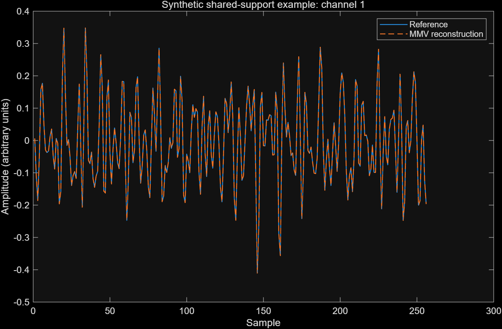

# MMV-based EMG Signal Reconstruction for Remote Rehabilitation

**MATLAB research code accompanying a ROBIO 2024 paper on joint reconstruction of multichannel surface electromyography.**

[Paper / DOI](https://doi.org/10.1109/ROBIO64047.2024.10907304) · [中文说明](README.zh-CN.md) · [Reproduction guide](docs/REPRODUCIBILITY.md) · [Methods](docs/METHODS.md)

Ruihui Zhao, Haoxiang Zhang, and Yehao Ma. *2024 IEEE International Conference on Robotics and Biomimetics (ROBIO)*, pp. 1567–1572.

## Research overview

Multichannel sEMG recordings create substantial storage and transmission demands for remote rehabilitation. This work investigates compressed sensing with a multiple measurement vector (MMV) model, using shared sparse structure across channels to reconstruct signals jointly rather than applying single measurement vector (SMV) recovery independently.

The paper studies preprocessing, the discrete sine transform (DST) sparse basis, a custom BPBDMtx measurement matrix, and MMV orthogonal matching pursuit. It evaluates reconstruction SNR, error, energy recovery, sampling ratio, and reconstruction time on high-density mandibular sEMG and conventional leg-muscle recordings.

## What this repository contains

| Path | Purpose |
| --- | --- |
| `src/` | Maintained joint OMP solver and explicitly defined metrics |
| `examples/` | Seeded synthetic demonstration with an independent OMP baseline |
| `legacy/` | Historical MATLAB scripts from three experiment folders; local input paths redacted |
| `docs/` | Method, provenance, reproduction limits, and contribution statement |
| `data/` | Instructions for locally supplied recordings; no participant data |
| `paper/` | Publication reference and access information |
| `results/` | Demonstration output and validation status |

## Quick start

Requires MATLAB. The synthetic example uses base MATLAB functionality and does not require the original recordings. From the repository root:

```matlab
run('examples/demo_joint_sparse.m')
```

The script fixes the random seed to 42, constructs four signals with eight shared DST coefficients, takes 128 measurements of each 256-sample signal, and compares joint OMP with independent OMP using identical measurements and atom budgets. It asserts recovery of the shared support and relative reconstruction error below `1e-8`, saves metrics, and generates a reconstruction plot.

**This is a small synthetic algorithm check, not an sEMG experiment or a replication of the paper's reported results.** Its Gaussian measurement matrix differs from the paper's BPBDMtx setting. The maintained solver also changes numerical solution and stopping behavior; see the reproduction guide.



Validated in MATLAB R2025b on Windows; the shared-support and reconstruction-error assertions passed. The joint solver took 0.0327 s and independent recovery took 0.0116 s in this small run. This example does not demonstrate a speed advantage for MMV; see [execution details](results/validation.txt).

## Published findings and interpretation

The paper reports improved reconstruction SNR and reduced reconstruction time for MMV relative to SMV in its experiments. Table 1 reports approximately 20.33–20.86 dB for MMV versus 16.83–16.94 dB for SMV on eight two-channel recordings. These are **published values, not results regenerated by this repository**. They do not establish clinical effectiveness.

Historical scripts use inconsistent definitions for an output called `MSE`. The maintained code reports MSE, PRD, and NMSE separately; error percentages from historical MMV and SMV runs should not be compared without checking their formulas. Timing also depends on hardware, numerical solver, channel count, and stopping budget.

## Author contribution

Ruihui Zhao (repository maintainer and first author) reports responsibility for data acquisition, signal preprocessing, experiment code execution, analysis and summarization of results, and manuscript writing. This statement was supplied by the maintainer; it does not assign or exclude the contributions of the coauthors.

## Data and publication access

Raw recordings, participant photographs, named participant folders, downloaded third-party datasets, and reference-paper PDFs are not distributed here. The original working collection is approximately 4.1 GB and contains identifiable folder names. See [data access](data/README.md). The publisher PDF is referenced through its DOI; this repository does not redistribute that copy.

## Citation

```bibtex
@inproceedings{zhao2024mmv,
  author = {Ruihui Zhao and Haoxiang Zhang and Yehao Ma},
  title = {{MMV} based {EMG} Signal Reconstruction for Remote Rehabilitation},
  booktitle = {2024 IEEE International Conference on Robotics and Biomimetics (ROBIO)},
  year = {2024},
  pages = {1567--1572},
  doi = {10.1109/ROBIO64047.2024.10907304}
}
```

## Reuse and contact

No open-source license has been assigned pending confirmation of rights for historical and adapted code. Public availability does not grant a general reuse license. The paper and third-party datasets retain their respective terms. For research questions or data-access inquiries, open a GitHub issue without including participant information.
