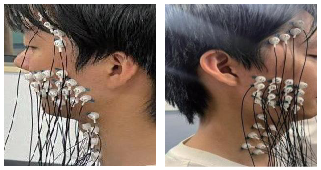
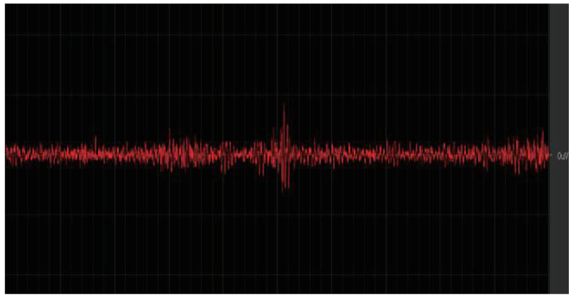
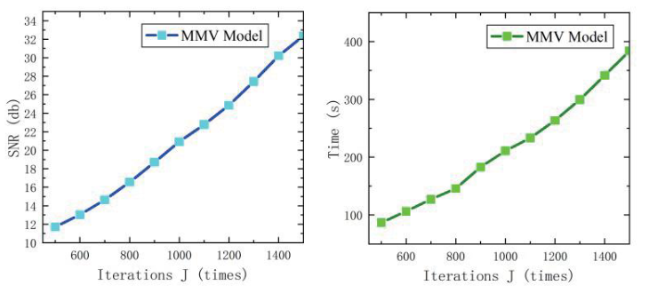
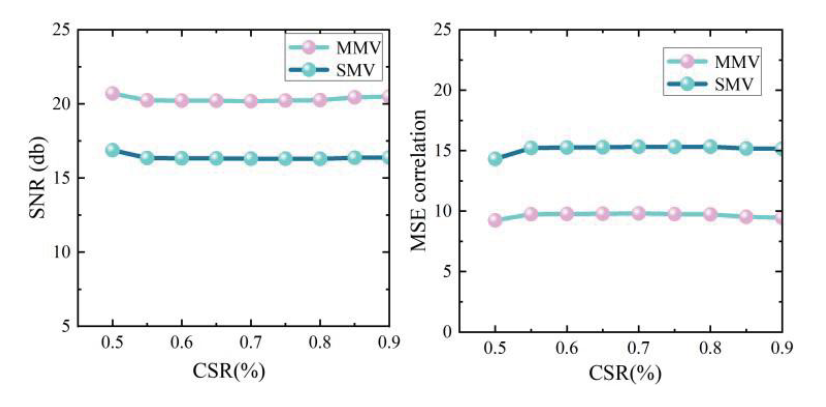
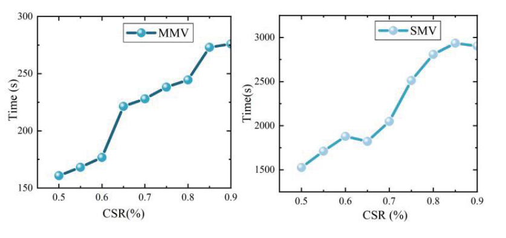
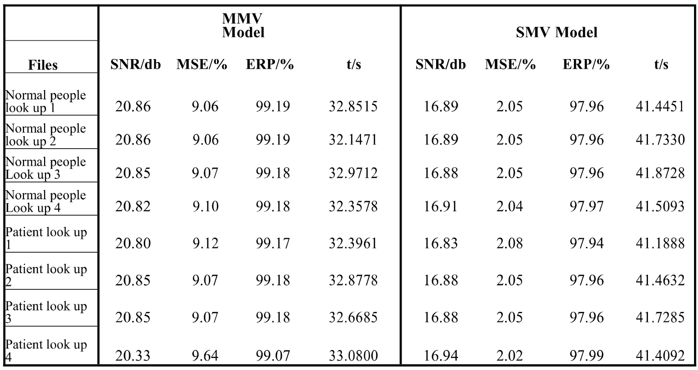

# MMV-based EMG Signal Reconstruction for Remote Rehabilitation

**MATLAB research code accompanying a ROBIO 2024 paper on joint reconstruction of multichannel surface electromyography.**

[Paper / DOI](https://doi.org/10.1109/ROBIO64047.2024.10907304) · [中文说明](README.zh-CN.md) · [Reproduction guide](docs/REPRODUCIBILITY.md) · [Methods](docs/METHODS.md)

Ruihui Zhao, Haoxiang Zhang, and Yehao Ma. *2024 IEEE International Conference on Robotics and Biomimetics (ROBIO)*, pp. 1567–1572.

## Research overview

Multichannel sEMG recordings create substantial storage and transmission demands for remote rehabilitation. This work investigates compressed sensing with a multiple measurement vector (MMV) model, using shared sparse structure across channels to reconstruct signals jointly rather than applying single measurement vector (SMV) recovery independently.

The paper studies preprocessing, the discrete sine transform (DST) sparse basis, a custom BPBDMtx measurement matrix, and MMV orthogonal matching pursuit. It evaluates reconstruction SNR, error, energy recovery, sampling ratio, and reconstruction time on high-density mandibular sEMG and conventional leg-muscle recordings.

## Repository structure

| Path | Purpose |
| --- | --- |
| `src/` | Maintained joint OMP solver and explicitly defined metrics |
| `examples/` | Seeded synthetic demonstration with an independent OMP baseline |
| `legacy/` | Historical code grouped into algorithms, measurement matrices, transforms, and experiment drafts; duplicates merged |
| `docs/` | Method, provenance, reproduction limits, and contribution statement |
| `data/` | Instructions for locally supplied recordings; no participant data |
| `paper/` | Publication reference and access information |
| `results/` | Demonstration output and validation status |

## Quick start

Requires MATLAB. The synthetic example uses base MATLAB functionality and does not require the original recordings. From the repository root:

```matlab
run('examples/demo_joint_sparse.m')
```

The script fixes the random seed to 42, constructs four signals with eight shared DST coefficients, takes 128 measurements of each 256-sample signal, and compares joint OMP with independent OMP using identical measurements and atom budgets. It asserts recovery of the shared support and relative reconstruction error below `1e-8`, saves metrics, and saves the numerical metrics.

**This is a small synthetic algorithm check, not an sEMG experiment or a replication of the paper's reported results.** Its Gaussian measurement matrix differs from the paper's BPBDMtx setting. The maintained solver also changes numerical solution and stopping behavior; see the reproduction guide.

## Figures and experimental results from the paper

All figures below are extracted directly from the supplied paper PDF. They retain the original subpanels and data; they are published results, not newly reproduced experiments. [Detailed bilingual figure guide and source notes](paper/FIGURES.md).

### Figure 1. High-density sEMG acquisition



The two photographs show the electrode placement on the mandibular and adjacent facial/neck region from two views. Section IV-A describes a 32-channel high-density sEMG acquisition setup. This figure documents the acquisition arrangement; it is not a reconstruction result.

### Figure 2. Single-channel sEMG waveform



The red trace is the single-channel sEMG signal shown in the paper. It illustrates the recorded signal and its time-varying activity. It does not overlay an original signal with a reconstruction. The source screenshot does not provide sufficiently readable calibrated axes, so no sampling duration or amplitude unit is inferred from it.

### Figure 3. Iteration budget: quality and runtime



The left panel plots reconstruction SNR against the MMV iteration budget J; the right panel plots reconstruction time against J. Both increase over the plotted range, showing the tradeoff between reconstruction quality and computational cost. The surrounding text describes a 50% sampling setting, p = 1, and K = 1000 for this iteration sweep. These curves are copied from the publication, not regenerated benchmarks.

### Figure 4. Reconstruction quality across sampling ratios



The left panel compares MMV and SMV reconstruction SNR; MMV remains above SMV over the plotted CSR range of 0.5-0.9. The right panel compares the error quantity labeled MSE correlation, where the MMV curve lies below the SMV curve in this figure. The paper defines CSR = Nc/N; its axis shows fractional values despite the CSR(%) label. The MSE label is preserved as published: its formula/scale must be reconciled with the historical scripts and Table 1 before making a uniform quantitative error comparison.

### Figure 5. Reconstruction time across sampling ratios



The left panel reports MMV reconstruction time and the right panel SMV reconstruction time. Their vertical axes use different ranges. MMV takes less time across the displayed sampling ratios, while runtime generally increases as more measurements are retained. In the surrounding 32-channel comparison, the paper describes approximately a tenfold speed difference near CSR = 0.5. That statement belongs to this experiment; it must not be transferred to the two-channel timing values in Table 1 or treated as a hardware-independent guarantee.

### Table 1. Two-channel reconstruction results



The table contains eight recording rows: four labeled Normal people look up and four labeled Patient look up. The caption refers to head-tilting and jaw opening/closing movements. The text states that two adjacent channels are selected. It reports SNR, an error column labeled MSE/%, ERP, and time for MMV and SMV. MMV SNR is 20.33-20.86 dB versus 16.83-16.94 dB for SMV; MMV time is 32.1471-33.0800 s versus 41.1888-41.8728 s for SMV. ERP is 99.07-99.19% versus 97.94-97.99%. The error columns are reproduced exactly and are not presented as directly comparable, because the supplied scripts use different error formulas. Eight rows do not establish eight unique participants.

## Author contribution

Ruihui Zhao (repository maintainer and first author) reports responsibility for data acquisition, signal preprocessing, experiment code execution, analysis and summarization of results, and manuscript writing. This statement was supplied by the maintainer; it does not assign or exclude the contributions of the coauthors.

## Data and publication access

Raw recordings, named participant folders, downloaded third-party datasets, and reference-paper PDFs are not distributed here. The acquisition photographs already published as Figure 1 are included in the attributed paper-figure gallery. The original working collection is approximately 4.1 GB and contains identifiable folder names. See [data access](data/README.md). The publisher PDF is referenced through its DOI; this repository does not redistribute that copy.

## Citation

```bibtex
@inproceedings{zhao2024mmv,
  author = {Ruihui Zhao and Haoxiang Zhang and Yehao Ma},
  title = {{MMV} based {EMG} Signal Reconstruction for Remote Rehabilitation},
  booktitle = {2024 IEEE International Conference on Robotics and Biomimetics (ROBIO)},
  year = {2024},
  pages = {1567--1572},
  doi = {10.1109/ROBIO64047.2024.10907304}
}
```

## Reuse and contact

No open-source license has been assigned pending confirmation of rights for historical and adapted code. Public availability does not grant a general reuse license. The paper and third-party datasets retain their respective terms. For research questions or data-access inquiries, open a GitHub issue without including participant information.
