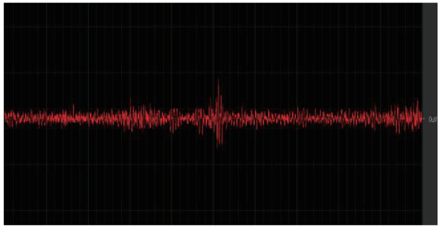
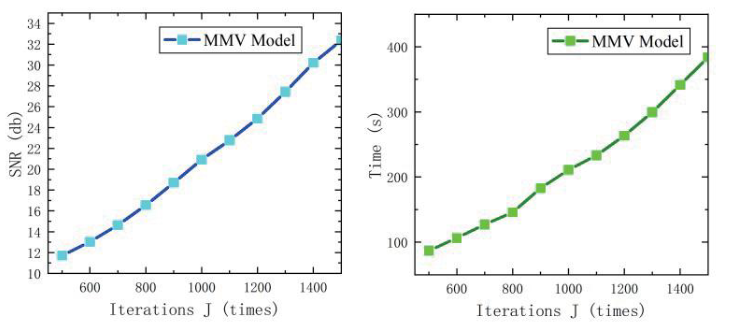
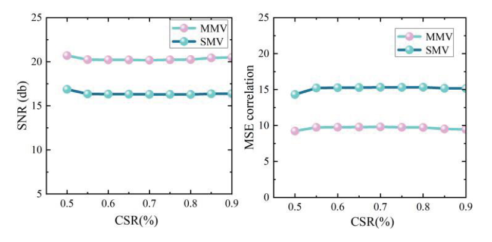
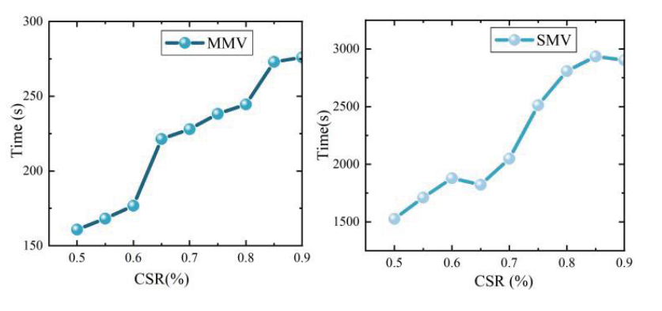
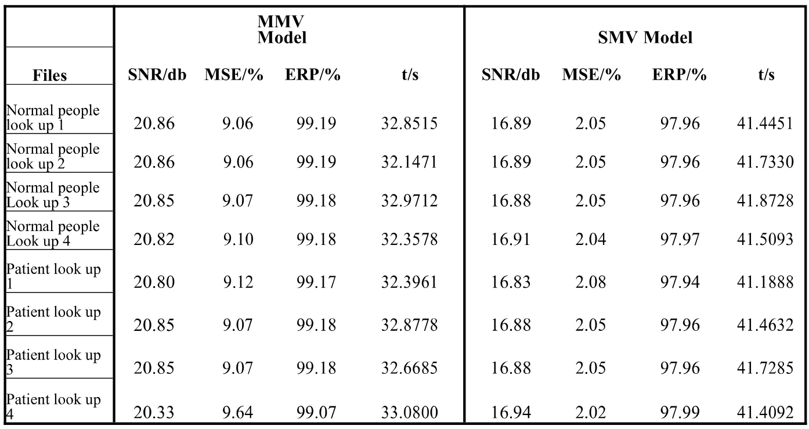

# 基于 MMV 的远程康复肌电信号重构

本仓库整理 ROBIO 2024 论文 **MMV based EMG Signal Reconstruction for Remote Rehabilitation** 的 MATLAB 研究代码，并提供独立的、固定随机种子的算法演示。

作者：Ruihui Zhao、Haoxiang Zhang、Yehao Ma。页码：1567–1572。

[论文 DOI](https://doi.org/10.1109/ROBIO64047.2024.10907304) · [English README](README.md)

## 研究内容

围绕远程康复中多通道表面肌电信号的数据传输与存储问题，研究多重测量向量模型（MMV）与正交匹配追踪，通过通道间共享稀疏结构进行联合重构。论文采用信号预处理、DST 稀疏基和 BPBDMtx 测量矩阵，并与逐通道 SMV 重构比较。

## 论文原始图表

主页展示的图表均已替换为论文 PDF 原图。完整 5 幅图及表 1 的中英文解读、实验参数、指标差异与来源页码见 [论文图表解读](paper/FIGURES.md)。原合成示例图已删除；合成代码只保留数值算法检查功能。


图 1：高密度表面肌电采集布局。两张照片从不同角度显示下颌及相邻面颈区域的电极布置。正文 IV-A 描述了 32 通道采集设置；这幅图用于说明采集方式，不是重构效果图。



图 2：单通道表面肌电波形。红色曲线是论文展示的单通道信号，用于说明信号形态及随时间变化的活动，不是原始信号与重构信号的对比。原图没有清晰可读的标定坐标，因此不额外推断时间长度或幅值单位。



图 3：迭代次数对重构质量和时间的影响。左图为迭代预算 J 与 SNR，右图为 J 与重构时间。两者随 J 增大而上升，反映质量与计算代价之间的取舍。相邻正文描述该扫描采用 50% 采样设置、p=1、K=1000。这些是论文原图，不是本次重新运行得到的曲线。



图 4：不同采样率下的重构质量。左图比较 MMV 与 SMV 的 SNR，在所绘 CSR=0.5–0.9 范围内，MMV 曲线高于 SMV；右图所标 MSE correlation 的 MMV 曲线低于 SMV。论文定义 CSR=Nc/N，横轴虽标 CSR(%)，刻度却是比例小数。原图标签原样保留；MSE 的公式和尺度需与历史代码、表 1 核对，不能直接把不同定义混作统一指标。



图 5：不同采样率下的重构耗时。左图为 MMV，右图为 SMV，两个子图的纵轴范围不同。图中 MMV 耗时更低，保留测量数增加时耗时总体上升。相邻的 32 通道比较中，正文描述 CSR=0.5 附近有约一个数量级的耗时差异；这一描述仅对应该实验，不能套用到表 1 的双通道结果或作为与硬件无关的保证。



表 1：双通道重构结果。包含 8 行记录，前四行为 Normal people look up，后四行为 Patient look up；表题提到抬头及下颌开合动作，正文说明选取相邻两个通道。指标包括 SNR、标作 MSE/% 的误差、ERP 和时间。MMV 的 SNR 为 20.33–20.86 dB，SMV 为 16.83–16.94 dB；MMV 耗时 32.1471–33.0800 s，SMV 为 41.1888–41.8728 s；ERP 分别为 99.07–99.19% 与 97.94–97.99%。误差列原样保留，不将公式不同的数值直接比较；8 行记录不等于 8 位不同受试者。


## 运行方式

在 MATLAB 中进入本仓库，执行：

```matlab
run('examples/demo_joint_sparse.m')
```

示例使用人工生成的共享稀疏信号，无需受试者数据；会检查支持集和重构误差，输出数值指标。示例使用高斯测量矩阵，因此不等同于论文实验，也不能用来声称复现了论文的 SNR 或加速倍数。

## 结构与边界

- `src/`：整理后的联合 OMP 与指标计算。
- `examples/`：合成数据示例与逐通道 OMP 基线。
- `legacy/`：按重构算法、测量矩阵、稀疏变换和实验草稿分类的历史代码，已合并重复内容并替换本机绝对数据路径；仍有缺失依赖或参数不一致，不能直接一键复现。
- `docs/`：方法、复现限制、来源记录和贡献说明。
- `data/`：数据使用说明，不含原始受试者记录。
- `paper/`：论文出版信息；通过 DOI 访问全文。
- `results/`：示例结果和实际验证记录。

历史代码中名为 MSE 的指标存在相对误差百分比、归一化平方误差等不同公式；整理版本分别报告 PRD、NMSE 和真正的 MSE。论文结果与本次验证结果分开标明。

Ruihui Zhao 提供的个人贡献说明：参与研究全流程，包括数据采集、预处理、代码运行、结果分析与总结、论文写作。不据此推断其他作者的贡献。

原始约 4.1 GB 的资料保持不变。包含姓名的目录、未在论文中展示的受试者照片、第三方数据库和参考论文全文不公开；论文图 1 中已发表的采集照片随原图展示；后续如发布实验数据，应先确认授权并完成匿名化。当前未擅自指定开源许可证。

