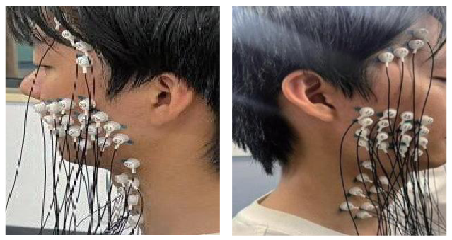
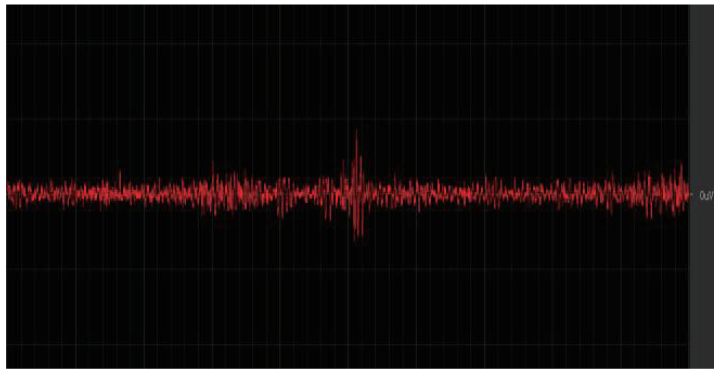
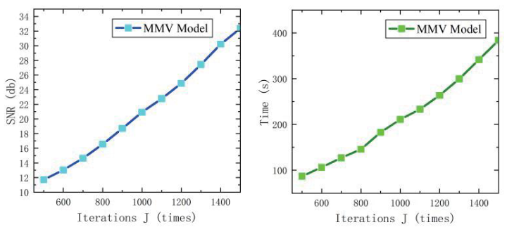
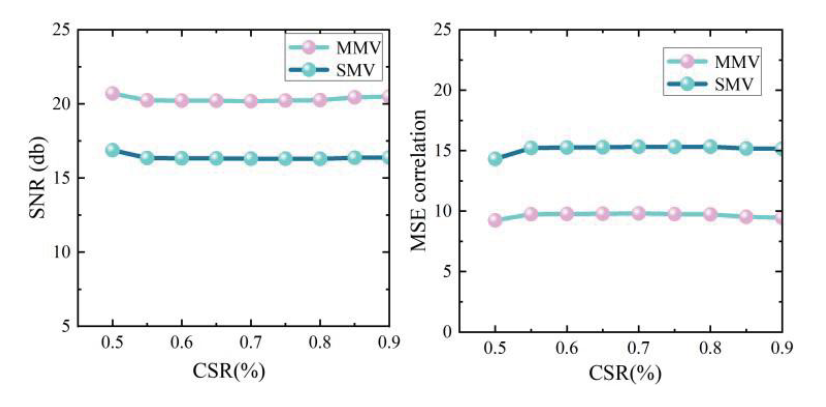
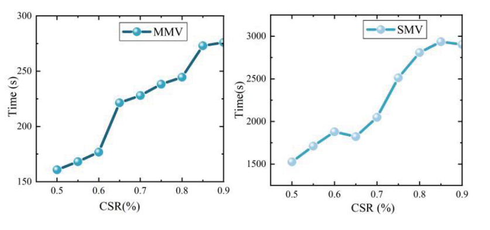
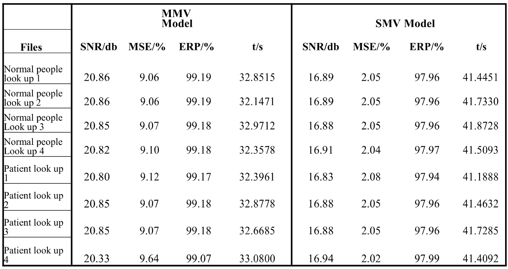

# Figures and results from the paper / 论文图表解读

Source: Ruihui Zhao, Haoxiang Zhang, and Yehao Ma, *MMV based EMG Signal Reconstruction for Remote Rehabilitation*, ROBIO 2024, pp. 1567–1572. [DOI](https://doi.org/10.1109/ROBIO64047.2024.10907304).

All five numbered figures and Table 1 were extracted from the supplied six-page publisher PDF. Images are rectangular crops rendered at scale 3, with all subpanels retained. No curve was redrawn, no values were invented, and no AI image generation was used. The photograph in Figure 1 is reproduced as it appears in the paper, without anonymization. These are published figures, not newly reproduced experimental results. Copyright remains with the respective rights holders; no new image license is assigned.

以下图表全部来自作者提供的论文 PDF，只作裁切，不重绘曲线、不修改数据、不生成替代图片。图 1 保留论文中原有采集照片，未作匿名化处理。图表均属于论文报告的结果，不代表仓库已重新复现这些实验。

## Experimental context / 实验背景

The paper describes extracting the first 3500 samples, applying a third-order Butterworth band-pass filter with normalized cutoffs [0.005, 0.45], removing the mean, and resampling to 5000 samples. It combines a discrete sine transform (DST) sparse basis, BPBDMtx measurements, and joint MMV-OMP reconstruction, with independent SMV recovery as comparison. Budgets vary among the experiments; the paper mentions both 800 and 1000, so no single configuration is assigned to every panel.

论文预处理包括取前 3500 个点、三阶 Butterworth 带通滤波（归一化截止频率 [0.005,0.45]）、去均值和重采样至 5000 点；重构流程采用 DST 稀疏基、BPBDMtx 测量矩阵与 MMV-OMP，并与逐通道 SMV 比较。不同实验的迭代/稀疏预算不同，不能把 800 或 1000 统一套用于每幅图。

## Figure 1. High-density sEMG acquisition

Source location: PDF page 3 / printed page 1569.

The two photographs show the electrode placement on the mandibular and adjacent facial/neck region from two views. Section IV-A describes a 32-channel high-density sEMG acquisition setup. This figure documents the acquisition arrangement; it is not a reconstruction result.

图 1：高密度表面肌电采集布局。两张照片从不同角度显示下颌及相邻面颈区域的电极布置。正文 IV-A 描述了 32 通道采集设置；这幅图用于说明采集方式，不是重构效果图。

## Figure 2. Single-channel sEMG waveform

Source location: PDF page 4 / printed page 1570.

The red trace is the single-channel sEMG signal shown in the paper. It illustrates the recorded signal and its time-varying activity. It does not overlay an original signal with a reconstruction. The source screenshot does not provide sufficiently readable calibrated axes, so no sampling duration or amplitude unit is inferred from it.

图 2：单通道表面肌电波形。红色曲线是论文展示的单通道信号，用于说明信号形态及随时间变化的活动，不是原始信号与重构信号的对比。原图没有清晰可读的标定坐标，因此不额外推断时间长度或幅值单位。

## Figure 3. Iteration budget: quality and runtime

Source location: PDF page 4 / printed page 1570.

The left panel plots reconstruction SNR against the MMV iteration budget J; the right panel plots reconstruction time against J. Both increase over the plotted range, showing the tradeoff between reconstruction quality and computational cost. The surrounding text describes a 50% sampling setting, p = 1, and K = 1000 for this iteration sweep. These curves are copied from the publication, not regenerated benchmarks.

图 3：迭代次数对重构质量和时间的影响。左图为迭代预算 J 与 SNR，右图为 J 与重构时间。两者随 J 增大而上升，反映质量与计算代价之间的取舍。相邻正文描述该扫描采用 50% 采样设置、p=1、K=1000。这些是论文原图，不是本次重新运行得到的曲线。

## Figure 4. Reconstruction quality across sampling ratios

Source location: PDF page 4 / printed page 1570.

The left panel compares MMV and SMV reconstruction SNR; MMV remains above SMV over the plotted CSR range of 0.5-0.9. The right panel compares the error quantity labeled MSE correlation, where the MMV curve lies below the SMV curve in this figure. The paper defines CSR = Nc/N; its axis shows fractional values despite the CSR(%) label. The MSE label is preserved as published: its formula/scale must be reconciled with the historical scripts and Table 1 before making a uniform quantitative error comparison.

图 4：不同采样率下的重构质量。左图比较 MMV 与 SMV 的 SNR，在所绘 CSR=0.5–0.9 范围内，MMV 曲线高于 SMV；右图所标 MSE correlation 的 MMV 曲线低于 SMV。论文定义 CSR=Nc/N，横轴虽标 CSR(%)，刻度却是比例小数。原图标签原样保留；MSE 的公式和尺度需与历史代码、表 1 核对，不能直接把不同定义混作统一指标。

## Figure 5. Reconstruction time across sampling ratios

Source location: PDF page 4 / printed page 1570.

The left panel reports MMV reconstruction time and the right panel SMV reconstruction time. Their vertical axes use different ranges. MMV takes less time across the displayed sampling ratios, while runtime generally increases as more measurements are retained. In the surrounding 32-channel comparison, the paper describes approximately a tenfold speed difference near CSR = 0.5. That statement belongs to this experiment; it must not be transferred to the two-channel timing values in Table 1 or treated as a hardware-independent guarantee.

图 5：不同采样率下的重构耗时。左图为 MMV，右图为 SMV，两个子图的纵轴范围不同。图中 MMV 耗时更低，保留测量数增加时耗时总体上升。相邻的 32 通道比较中，正文描述 CSR=0.5 附近有约一个数量级的耗时差异；这一描述仅对应该实验，不能套用到表 1 的双通道结果或作为与硬件无关的保证。

## Table 1. Two-channel reconstruction results

Source location: PDF page 5 / printed page 1571.

The table contains eight recording rows: four labeled Normal people look up and four labeled Patient look up. The caption refers to head-tilting and jaw opening/closing movements. The text states that two adjacent channels are selected. It reports SNR, an error column labeled MSE/%, ERP, and time for MMV and SMV. MMV SNR is 20.33-20.86 dB versus 16.83-16.94 dB for SMV; MMV time is 32.1471-33.0800 s versus 41.1888-41.8728 s for SMV. ERP is 99.07-99.19% versus 97.94-97.99%. The error columns are reproduced exactly and are not presented as directly comparable, because the supplied scripts use different error formulas. Eight rows do not establish eight unique participants.

表 1：双通道重构结果。包含 8 行记录，前四行为 Normal people look up，后四行为 Patient look up；表题提到抬头及下颌开合动作，正文说明选取相邻两个通道。指标包括 SNR、标作 MSE/% 的误差、ERP 和时间。MMV 的 SNR 为 20.33–20.86 dB，SMV 为 16.83–16.94 dB；MMV 耗时 32.1471–33.0800 s，SMV 为 41.1888–41.8728 s；ERP 分别为 99.07–99.19% 与 97.94–97.99%。误差列原样保留，不将公式不同的数值直接比较；8 行记录不等于 8 位不同受试者。

## Reading the publication carefully / 阅读注意

- The actual captions number the figures 1 through 5. Page 1570 refers to Figure 5 while discussing the quality plot actually captioned Figure 4, and to Figure 6 while discussing the time plot captioned Figure 5. This gallery follows the captions and does not invent a sixth figure.
- Figure 4, Table 1, the paper equation for MSE, and different historical scripts do not use visibly consistent error labels/scales. This repository preserves the source presentation and flags the discrepancy; it does not silently correct the paper or claim all error columns are equivalent.
- Approximate visual trends are described qualitatively. Exact numerical ranges above are transcribed from Table 1, not read from graph pixels. Timing depends on the experimental configuration and hardware.
- The figures document acquisition and signal reconstruction; they do not demonstrate clinical rehabilitation outcomes.

原文存在图号错位，以及不同位置 MSE 标注、公式和尺度不一致的问题。这里保留原图并说明差异，不擅自改写原始结果。曲线只作趋势解读，精确数值范围来自表 1。图表展示的是采集与信号重构研究，不能据此推断临床康复疗效。

See [extraction manifest](figures/manifest.json) for source-page locations, crop bounds, and SHA-256 hashes.
